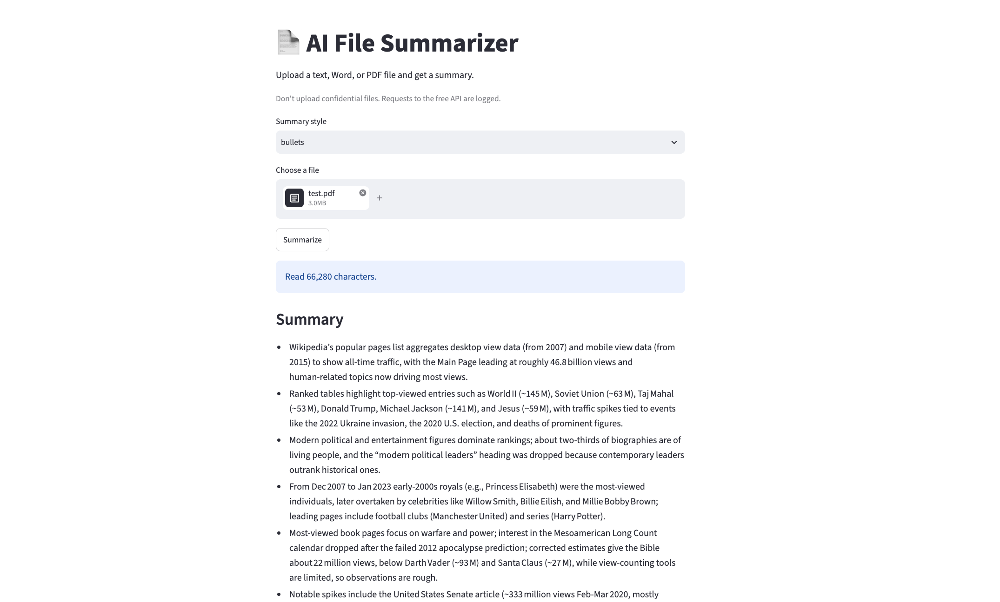

# AI File Summarizer

Summarize PDF, Word, and text files with an LLM, from the command line or a small web app. Long documents are handled by splitting them into chunks, summarizing each chunk, and then summarizing the summaries.



## Features
- Reads `.pdf`, `.docx`, `.txt`, and `.md` files
- Three summary styles: `short`, `bullets`, `detailed`
- Handles long documents with chunking and recursive (map-reduce) summarization. Tested on a 66,000-character PDF
- Retries with increasing pauses when the free API is busy or returns an empty reply
- Command-line interface (`argparse`) with an optional `--save` flag
- Streamlit web app with file upload, live progress, and a download button

## How it works
1. The file is read into plain text.
2. Text longer than one request is split into paragraph-based chunks.
3. Each chunk is summarized separately.
4. The partial summaries are combined and summarized again, repeating until the text fits in one request. The chosen style is applied at the final step.

## Setup
```bash
git clone https://github.com/Atharv-Kakade/ai-file-summarizer.git
cd ai-file-summarizer
uv venv
source .venv/bin/activate
uv pip install -r requirements.txt
cp .env.example .env    # then add your API key and a model name
```

## Usage
Command line:
```bash
python summarizer.py report.pdf --style bullets
python summarizer.py notes.docx --style detailed --save
```

Web app:
```bash
streamlit run app.py
```

## Limitations
- Scanned PDFs (images of text) are not supported because there is no OCR step.
- For very long files, the `detailed` style works from the partial summaries, so fine details can be lost.
- The free API can be slow or busy, so long files may take several minutes.
- Don't upload confidential files. Requests to the free API may be logged.

## Tech
Python 3.12, openai (OpenAI-compatible API), pypdf, python-docx, Streamlit, python-dotenv